<h1 align="center">▸ green-core-stats</h1>

<p align="center">
  <b>Retro-futuristic GitHub stats cards that live in your own repo.</b><br/>
  No external server, no rate limits, no "Error Fetching Resource".
</p>

<p align="center">
  <a href="https://github.com/FilipeHSAraujo/green-core-stats/actions/workflows/ci.yml"></a>
  
  
  
</p>

<p align="center">
  
  
</p>
<p align="center"><sub>▲ live cards for <a href="https://github.com/FilipeHSAraujo">@FilipeHSAraujo</a>, regenerated every day by this repo's own action</sub></p>

---

## ▸ Why

Most profile READMEs load their stats cards from a shared public server. When that server gets too much traffic, it pauses and every profile using it shows a broken image (`503 DEPLOYMENT_PAUSED`).

**green-core-stats** turns that around: a GitHub Action reads your public data once a day, draws two SVG cards and commits them to your repository. Your README only shows files that are already there, so it never depends on anyone else's server.

## ▸ Use it

In your profile repository (`<your-username>/<your-username>`), create `.github/workflows/stats.yml`:

```yaml
name: Update stats cards

on:
  schedule:
    - cron: "17 6 * * *"   # every day
  workflow_dispatch:        # "Run workflow" button

permissions:
  contents: write

jobs:
  cards:
    runs-on: ubuntu-latest
    steps:
      - uses: actions/checkout@v4
      - uses: FilipeHSAraujo/green-core-stats@v1
        with:
          theme: green-core
```

Run it once from the **Actions** tab, then add the cards to your `README.md`:

```html
<p align="center">
  
  
</p>
```

## ▸ Options

| Input | Default | What it does |
| :--- | :--- | :--- |
| `username` | repository owner | Account the cards are built for |
| `theme` | `green-core` | `green-core`, `amber-terminal`, `ice-blue` or `vaporwave` |
| `output-dir` | `assets` | Folder for `stats.svg` and `langs.svg` |
| `langs-count` | `6` | Languages shown on the languages card (1 to 6) |
| `commit` | `true` | Commit and push the cards. Set `false` to handle it yourself |
| `token` | `github.token` | Token used to read the API. The default one is enough |

## ▸ Themes

<sub>Rendered with fictional sample data.</sub>

| `green-core` | `amber-terminal` |
| :---: | :---: |
| <br/> | <br/> |
| **`ice-blue`** | **`vaporwave`** |
| <br/> | <br/> |

## ▸ What the cards count

- **Stats:** total stars on your public repos, commits and contributions in the last year (private contributions are counted only if you enabled them on your profile), pull requests, issues and public repos.
- **Languages:** bytes of code per language across your public, non-fork repositories, as a share of the total.

## ▸ Quality

The rendering code is made of pure functions (data in, SVG out), so it is tested without touching the network.

```bash
npm test          # 29 tests: aggregation, edge cases, escaping, all themes, API errors
npm run examples  # regenerate examples/ from sample data
```

CI runs the suite on Node 20 and 22 for every push and pull request, plus a smoke test of the command line tool.

Edge cases covered by the tests include a brand-new account with no data, repos with zero-byte or malformed language entries, user names with characters that would break the SVG, unknown themes, invalid tokens, unknown users and non-JSON API responses.

## ▸ Project layout

```text
action.yml            composite action: setup Node, generate, commit
src/render.mjs        pure rendering + aggregation functions
src/themes.mjs        color themes
src/github.mjs        GraphQL query and API error handling
src/cli.mjs           entry point used by the action
test/                 node:test suites
examples/             theme previews (sample data)
demo/                 live cards, updated by .github/workflows/demo.yml
```

## ▸ Run locally

```bash
# sample data, no token needed (macOS / Linux / Git Bash)
GCS_SAMPLE=1 GCS_OUTPUT_DIR=out node src/cli.mjs

# your real data
GITHUB_TOKEN=<token> GCS_USERNAME=<user> GCS_THEME=vaporwave node src/cli.mjs
```

---

<p align="center">
  <sub>Made by <a href="https://github.com/FilipeHSAraujo">Filipe Araujo</a> · transmitted from <a href="https://arquelphi.neocities.org/">Arquelphi's Palace</a> · MIT</sub>
</p>
